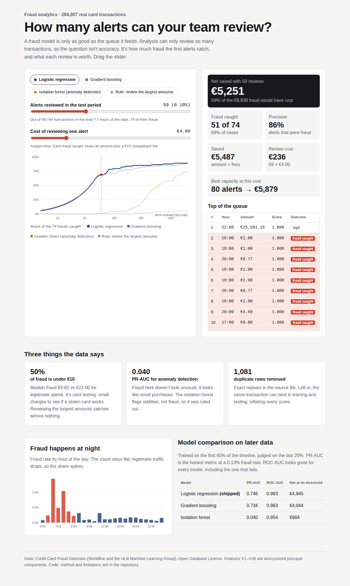
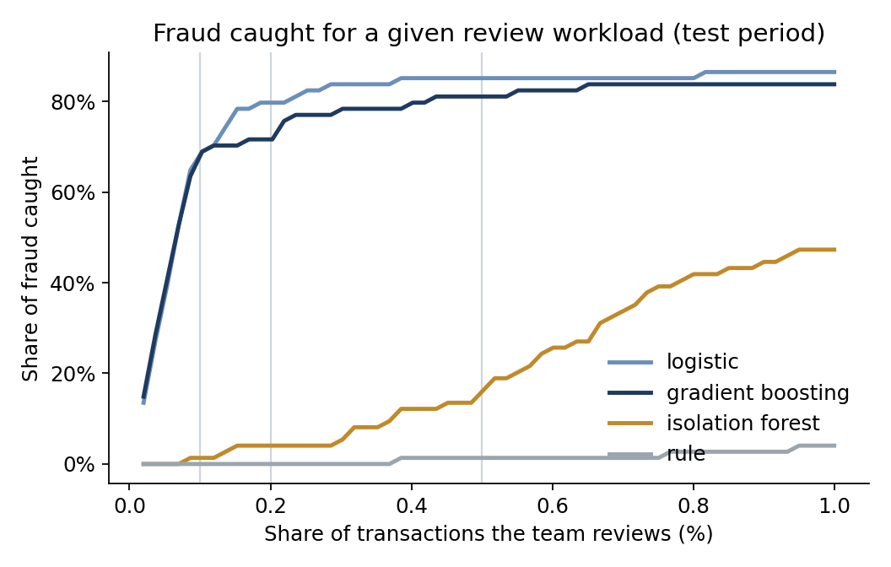
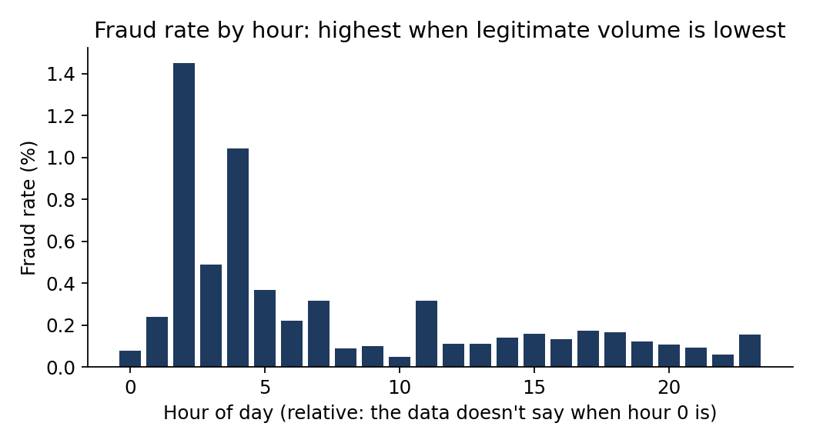

# Card Fraud Detection

**Live demo:** https://card-fraud-detection.vercel.app (drag the review-capacity slider and watch fraud caught, precision and euros saved change)



Fraud detection on 284,807 real card transactions, evaluated the way a fraud operation runs: analysts can review only so many alerts, so what matters is how much fraud lands in the review queue, how much money that stops, and where the alert threshold should sit once review costs are counted.



## The short version

- **Reviewing 0.1% of transactions catches 69% of fraud.** On the test period, the top 57 alerts from the logistic model hold 51 of the 74 frauds, at 89% precision.
- **The simpler model won.** Logistic regression (PR-AUC 0.746) edges gradient boosting (0.734) on later data. With a time-based split, the flexible model's extra fit to the training days didn't carry forward.
- **Anomaly detection without labels nearly failed** (PR-AUC 0.040). Fraud here doesn't look "unusual" in the way an isolation forest measures, so "use unsupervised learning for fraud" isn't a free win. It's a fallback for when labels don't exist yet, not a replacement.
- **Flagging large transactions catches nothing.** Fraud here is mostly small: a median of €9.82 against €22 for legitimate purchases, with 50% under €10. That's the signature of card testing, where fraudsters try a stolen card with tiny charges before spending it.
- **A cost-based threshold keeps 56% of potential fraud losses.** Chosen on validation data, then applied to the test period, it nets €4,945 out of €8,838 at stake.

## Data

The ULB credit card fraud dataset: transactions by European cardholders over two days in September 2013, collected by Worldline and the Machine Learning Group of Université Libre de Bruxelles (Dal Pozzolo et al., 2015), under the Open Database License. It's 284,807 transactions and 492 frauds. For confidentiality, the bank released 28 features already transformed by PCA (`V1` to `V28`), plus the amount and the seconds elapsed since the first transaction.

That last point limits feature engineering. With anonymized components, the usual fraud features (merchant, device, velocity per card, distance from home) can't be built, so this project focuses on what can still be done well: evaluation, thresholds, and the operations around the model.

**Cleaning.** 1,081 exact duplicate rows were removed, including 19 frauds, so the same transaction can't sit in both training and test. That leaves 473 frauds (0.167%).

**A time-based split.** Training uses the first 60% of the period, validation the next 20%, and test the last 20%. The fraud rate moves a lot over time:

| Period | Transactions | Frauds | Fraud rate |
|---|---|---|---|
| Train | 170,236 | 342 | 0.201% |
| Val | 56,746 | 57 | 0.100% |
| Test | 56,744 | 74 | 0.130% |

A random split would blend those periods and flatter every model. A real fraud model always predicts on next week, never on a shuffled copy of last week.

## Results at fixed review capacity

How many of the test period's 74 frauds land in the queue, with precision in brackets, when the team reviews the top 0.1%, 0.2% or 0.5% of transactions:

| Approach | PR-AUC | Review 0.1% | Review 0.2% | Review 0.5% | Fraud value caught at 0.1% |
|---|---|---|---|---|---|
| Logistic regression | 0.746 | 51 (89%) | 59 (52%) | 63 (22%) | €4,722 |
| Gradient boosting | 0.734 | 50 (88%) | 53 (47%) | 60 (21%) | €3,534 |
| Isolation forest (no labels) | 0.040 | 1 (2%) | 3 (3%) | 11 (4%) | €296 |
| Rule: review the largest amounts | 0.001 | 0 (0%) | 0 (0%) | 1 (0%) | €0 |

PR-AUC (average precision) is the headline metric rather than ROC AUC. At a 0.13% fraud rate, ROC AUC looks excellent for almost any model, because it gives the huge number of easy legitimate transactions as much weight as the rare frauds.

## Where to set the threshold

An alert costs about €4 of analyst time. A missed fraud costs its amount plus about €15 in chargeback fees. The threshold that maximizes net savings is chosen on the validation period, then applied unchanged to the test period:

| Model | Alerts | Frauds caught | Losses avoided | Review cost | Net savings |
|---|---|---|---|---|---|
| Logistic regression | 340 | 63 | €6,305 | €1,360 | **€4,945** |
| Gradient boosting | 64 | 51 | €4,300 | €256 | **€4,044** |
| Isolation forest | 1,072 | 43 | €4,952 | €4,288 | **€664** |

With no review at all, the test period's fraud would cost €8,838.

Gradient boosting's threshold is much tighter (fewer alerts, fewer catches), and the logistic model's is looser. Both are reasonable. The validation period had only 57 frauds, so the chosen threshold carries real uncertainty. In production I'd set it from several weeks of data, and revisit it as fraud patterns and analyst capacity change.



In the six quietest hours (hours 1 to 6, overnight if hour 0 is midnight; the data doesn't say), the fraud rate is 0.64%, more than four times the 0.15% of the six busiest hours. The number of frauds per hour barely changes, about 20 against 24. Fraud runs at a steady pace around the clock, and it's legitimate spending that disappears at night. So a fixed alert budget per hour works much harder overnight, and night-time alerts deserve priority in the queue.

## Running it

```bash
pip install -r requirements.txt
python -m src.pipeline      # downloads the data on first run (about 100 MB), trains, evaluates, writes results/ and docs/
pytest -q
```

`results/test_scores.csv` holds every test transaction's score from each model, ready for a Tableau or Power BI alert-queue dashboard.

## What I'd do next

- **Velocity and history features,** with raw data: transactions per card in the last hour, a new merchant category, distance from the last transaction. They usually beat anything a model can learn from anonymized components.
- **Delayed labels.** Chargebacks arrive weeks after the transaction, so the model trains on a delayed, incomplete picture of recent fraud. The evaluation should mimic that lag.
- **Feedback from analysts.** Every reviewed alert is a fresh label. Retrain on them, while watching for the bias that comes from only ever labeling what the model chose to flag.
